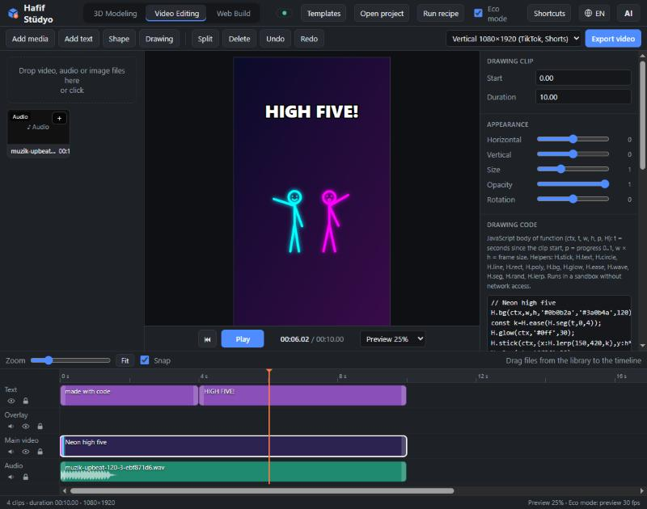
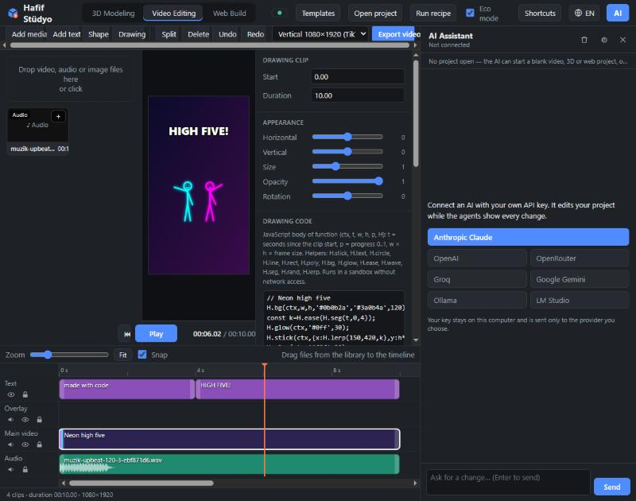
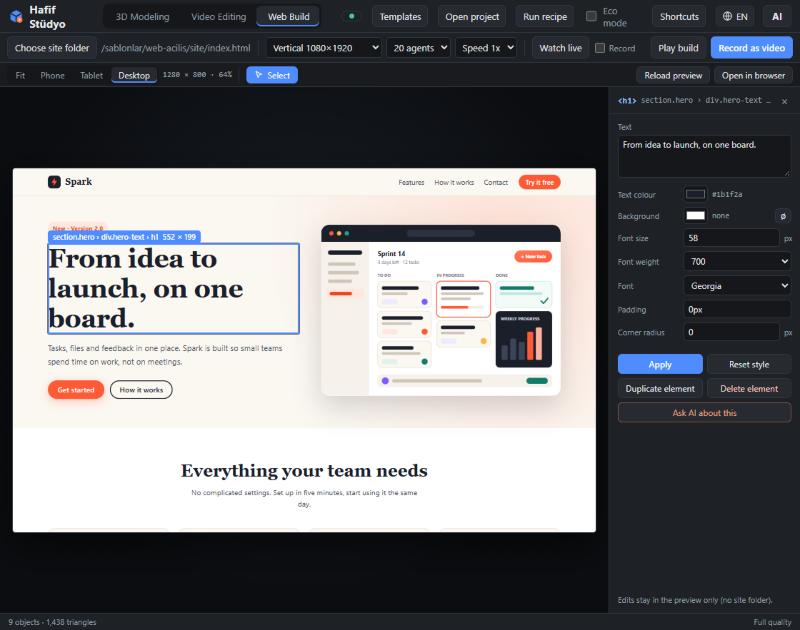
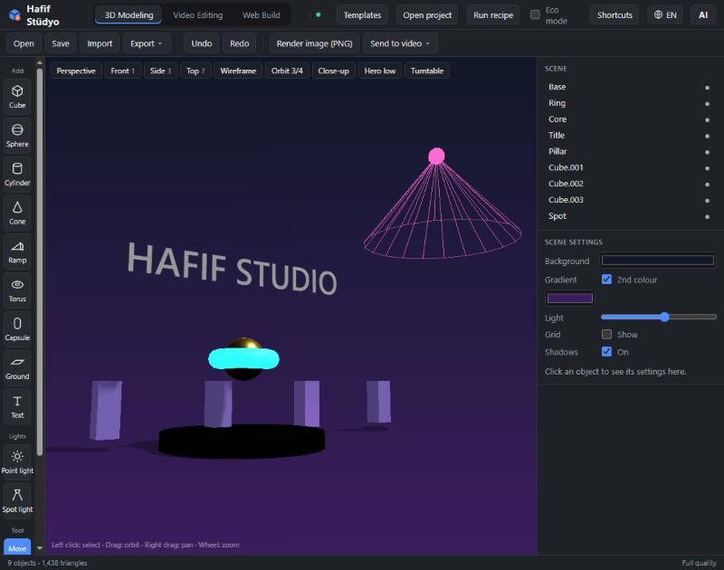

# Hafif Stüdyo (Light Studio)

**English** | [Türkçe](README.tr.md)

A lightweight desktop studio for **3D modelling, video editing and web-site building**, designed for weak PCs (it was developed on a GTX 1050 Ti). AI agents can edit your project **live** while you watch: coloured cursors move, select and change things in real time. Connect Claude (or another AI) with your own API key, or drive the app from Claude Code.



## Features

- **3D mode**: primitives, materials, lights, camera, GLB/OBJ/STL import and export, PNG renders and turntable videos (three.js).
- **Video mode**: Premiere-style timeline with effects and looks, transitions, Ken Burns motion, speed, crop, styled and animated text, shapes, track mute/hide/lock, ripple delete, markers, J/K/L, export presets (MediaRecorder; optional ffmpeg for MP4).
- **Draw clips**: video layers drawn by JavaScript (stick figures, characters, motion graphics) in a sandboxed worker, with a small helper library.
- **Generated music**: procedural background music in six styles (upbeat, chill, epic, lofi, chiptune, cinematic), no files needed.
- **Web mode**: the AI writes and edits your site from chat while you watch; click any element to edit text, colours and fonts (saved to the files) or send it to the AI; phone, tablet and desktop preview; record the build as an animated video.
- **AI agents overlay**: up to 20 agents animate every edit with named, coloured cursors.
- **Live projects**: an AI edits `proje.json`, the app applies the diff live with agent animations; your own edits in the UI are written back.
- **Templates**: ready-made projects (3D logo, product turntable, TikTok promo, text video, web opening, landscape promo), in English by default.
- **Recipes**: describe a whole job in JSON and run it headless from the command line.
- **20 languages**: English by default, auto-detected from your system language (English, Chinese, Hindi, Spanish, French, Arabic, Bengali, Portuguese, Russian, Japanese, German, Korean, Turkish, Italian, Indonesian, Vietnamese, Urdu, Polish and more). Switchable in the app.
- **Light on resources**: renders on demand, no permanent animation loop, idle CPU/GPU about 0.

| AI assistant | Web mode | 3D mode |
|---|---|---|
|  |  |  |

## Quick start

**Download:** get `HafifStudyo.exe` from the [Releases](../../releases) page and run it (Windows 10/11; needs the WebView2 runtime, which is built into current Windows).

**Build from source** (Node 20+):

```
npm ci
npx neu update
node tools/package.mjs     # -> dist/HafifStudyo.exe
```

`node build.mjs` only bundles `src/` into `resources/index.html` (and `dist-web/HafifStudyo.html` for the browser).

**ffmpeg (optional):** install [ffmpeg](https://ffmpeg.org) and put it on your `PATH` for MP4 conversion and screen-recorded build videos. It is not bundled.

## Connecting an AI

- **Your own API key:** enter a Claude (or other provider) API key in the app settings. The key stays on your machine.
- **Claude Code:** use `tools/hs-run.ps1` (also shipped next to the exe as `dist/hs-run.ps1`):

```powershell
.\hs-run.ps1 -New logo-3d            # open a live project from a template
.\hs-run.ps1 -Open C:\path\to\folder # open an existing live project
.\hs-run.ps1 -Say "Writing the hero section"   # show a note in the app
.\hs-run.ps1 -Export                 # export MP4/PNG/GLB of the live project
.\hs-run.ps1 -Close                  # end the live session
.\hs-run.ps1 -Live C:\path\to\site -Record -Orientation vertical   # watch a site being written live
.\hs-run.ps1 -Recipe job.json -Headless   # run a recipe without opening a window
```

## Documentation

Docs are currently written in Turkish and are being translated to English.

- [docs/TARIF.md](docs/TARIF.md): recipe format
- [docs/CANLI.md](docs/CANLI.md): live projects (`proje.json`)
- [docs/MIMARI.md](docs/MIMARI.md): architecture and module contracts

## Project structure

```
src/          app source (ES modules, CSS), bundled by esbuild
src/locales/  translations (one JSON per language)
resources/    static assets for Neutralino (index.html is generated)
sablonlar/    project templates
ornekler/     example recipes, live projects and sample media
docs/         documentation, docs/img screenshots
tools/        hs-run.ps1, packaging and helper scripts
HafifStudyo.html   the original single-file v1 version
```

## Performance notes

No permanent `requestAnimationFrame` loops and no idle timers: drawing happens only when something changes. Agent animations stop when the job ends. Contributions must keep this property.

## Roadmap

- English documentation and recipe reference
- More templates and effects
- macOS / Linux builds (Neutralino supports them; untested)

## License

[MIT](LICENSE). Third-party components: [THIRD_PARTY_NOTICES.md](THIRD_PARTY_NOTICES.md). See also [CONTRIBUTING.md](CONTRIBUTING.md).
