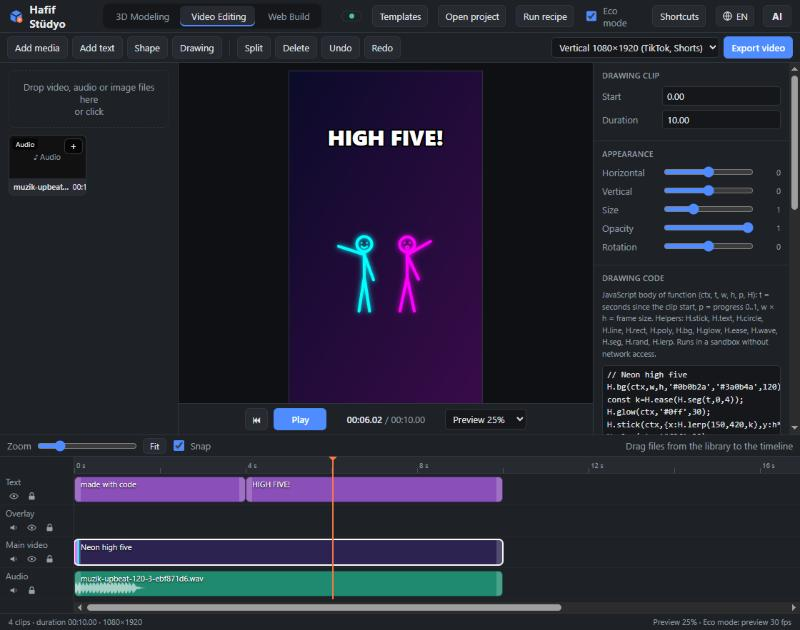

# Hafif Stüdyo

[English](README.md) | **Türkçe**

Zayıf bilgisayarlar için tasarlanmış hafif bir masaüstü stüdyo: **3D modelleme, video düzenleme ve web sitesi yapımı** (GTX 1050 Ti üzerinde geliştirildi). Yapay zeka ajanları projeni **canlı** düzenler; renkli imleçler gerçek zamanlı olarak seçer ve değiştirir. Kendi API anahtarınla Claude'u (ya da başka bir yapay zekayı) bağlayabilir veya uygulamayı Claude Code'dan yönetebilirsin.



## Özellikler

- **3D modu**: temel şekiller, malzeme, ışık, kamera, GLB/OBJ/STL içe/dışa aktarma, PNG render ve dönen ürün videosu (three.js).
- **Video modu**: zaman çizelgesi, yazı, efekt, müzik, MP4/WebM dışa aktarma (MP4 için ffmpeg isteğe bağlı).
- **Çizim klipleri**: JavaScript ile çizilen video katmanları (çöp adam, karakter, hareketli grafik); kum havuzlu worker'da, küçük bir yardımcı kütüphaneyle çalışır.
- **Üretilen müzik**: dosyasız, altı stilde (upbeat, chill, epic, lofi, chiptune, cinematic) yordamsal arka plan müziği.
- **Web yapılış modu**: site kur ve yapılışını animasyonlu videoya çevir.
- **Ajan katmanı**: 20'ye kadar ajan her düzenlemeyi renkli imleçlerle canlandırır.
- **Canlı projeler**: yapay zeka `proje.json` dosyasını düzenler, uygulama farkı ajan animasyonlarıyla canlı uygular; arayüzde yaptığın değişiklikler dosyaya geri yazılır.
- **Şablonlar**: hazır projeler (3D logo, dönen ürün, TikTok tanıtım, yazı videosu, web açılış, yatay tanıtım); varsayılan olarak İngilizce.
- **Tarifler**: tüm işi JSON ile tarif et, komut satırından pencere açmadan çalıştır.
- **20 dil**: varsayılan İngilizce, sistem dilinden otomatik algılanır; Türkçe dahil en popüler 20 dil, uygulamadan değiştirilebilir.
- **Hafif**: gerektiğinde çizer, sürekli animasyon döngüsü yok, boşta CPU/GPU yaklaşık 0.

## Hızlı başlangıç

**İndir:** [Releases](../../releases) sayfasından `HafifStudyo.exe` dosyasını indirip çalıştır (Windows 10/11, WebView2 gerekir; güncel Windows'ta yerleşiktir).

**Kaynaktan derle** (Node 20+):

```
npm ci
npx neu update
node tools/package.mjs     # -> dist/HafifStudyo.exe
```

**ffmpeg (isteğe bağlı):** MP4 dönüşümü ve ekran kaydıyla yapılış videoları için [ffmpeg](https://ffmpeg.org) kur ve `PATH`'e ekle. Pakete dahil değildir.

## Yapay zekayı bağlama

- **Kendi API anahtarın:** uygulama ayarlarına Claude (veya başka sağlayıcı) anahtarını gir; anahtar bilgisayarında kalır.
- **Claude Code:** `tools/hs-run.ps1` (exe'nin yanında `dist/hs-run.ps1` olarak da gelir):

```powershell
.\hs-run.ps1 -New logo-3d            # şablondan canlı proje aç
.\hs-run.ps1 -Open C:\yol\klasor     # var olan canlı projeyi aç
.\hs-run.ps1 -Say "Hero bölümünü yazıyorum"   # uygulamada not göster
.\hs-run.ps1 -Export                 # canlı projeyi MP4/PNG/GLB olarak çıkar
.\hs-run.ps1 -Close                  # canlı oturumu bitir
.\hs-run.ps1 -Live C:\yol\site -Record -Orientation vertical   # siteyi yazılırken canlı izle
.\hs-run.ps1 -Recipe is.json -Headless   # tarifi pencere açmadan çalıştır
```

## Belgeler

- [docs/TARIF.md](docs/TARIF.md): tarif biçimi
- [docs/CANLI.md](docs/CANLI.md): canlı projeler (`proje.json`)
- [docs/MIMARI.md](docs/MIMARI.md): mimari ve modül sözleşmeleri

Belgeler Türkçedir; İngilizceye çevrilmektedir.

## Proje yapısı

```
src/          uygulama kaynağı (ES modülleri, CSS), esbuild ile paketlenir
src/locales/  çeviriler (dil başına bir JSON)
resources/    Neutralino statik dosyaları (index.html üretilir)
sablonlar/    proje şablonları
ornekler/     örnek tarifler, canlı projeler ve örnek medya
docs/         belgeler, docs/img ekran görüntüleri
tools/        hs-run.ps1, paketleme ve yardımcı betikler
HafifStudyo.html   orijinal tek dosyalı v1 sürümü
```

## Performans

Sürekli `requestAnimationFrame` döngüsü ve boşta zamanlayıcı yoktur; çizim yalnızca bir şey değişince yapılır. Katkılar bu özelliği korumalıdır.

## Yol haritası

- İngilizce belgeler
- Daha fazla şablon ve efekt
- macOS / Linux sürümleri (denenmedi)

## Lisans

[MIT](LICENSE). Üçüncü taraf bileşenler: [THIRD_PARTY_NOTICES.md](THIRD_PARTY_NOTICES.md). Katkı için [CONTRIBUTING.md](CONTRIBUTING.md).
